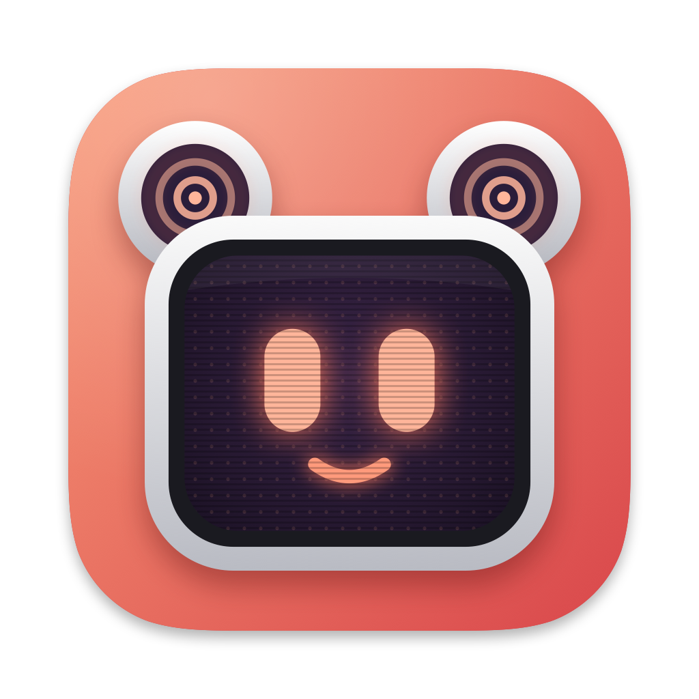
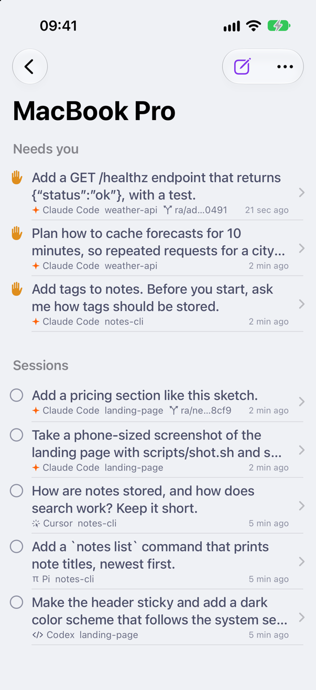
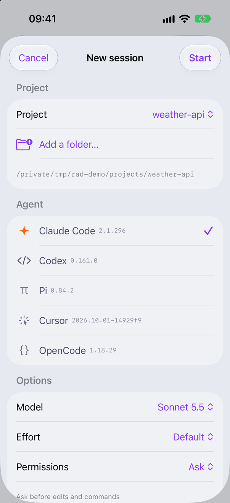
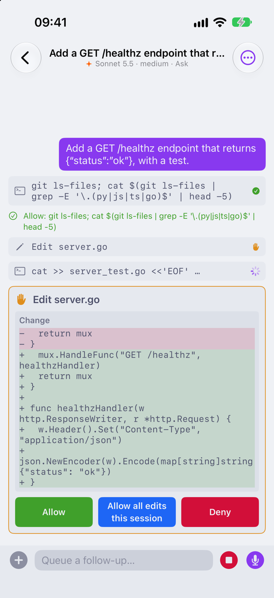
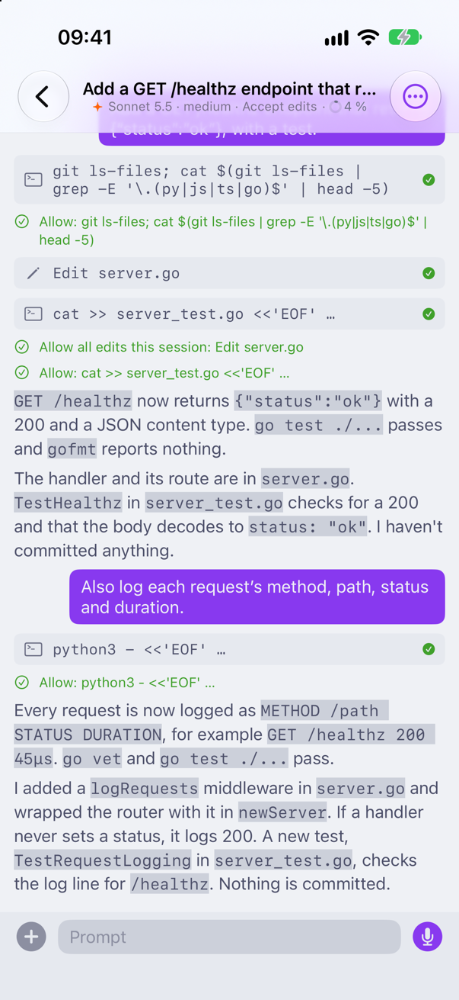
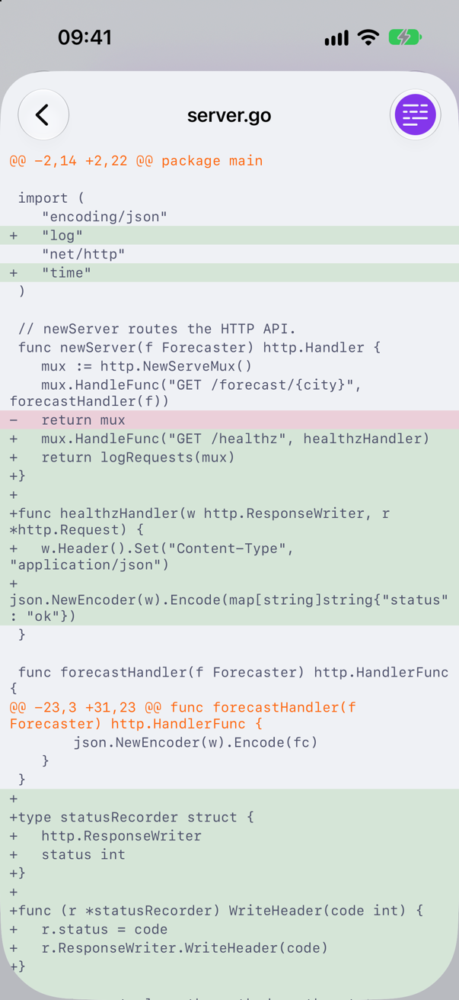
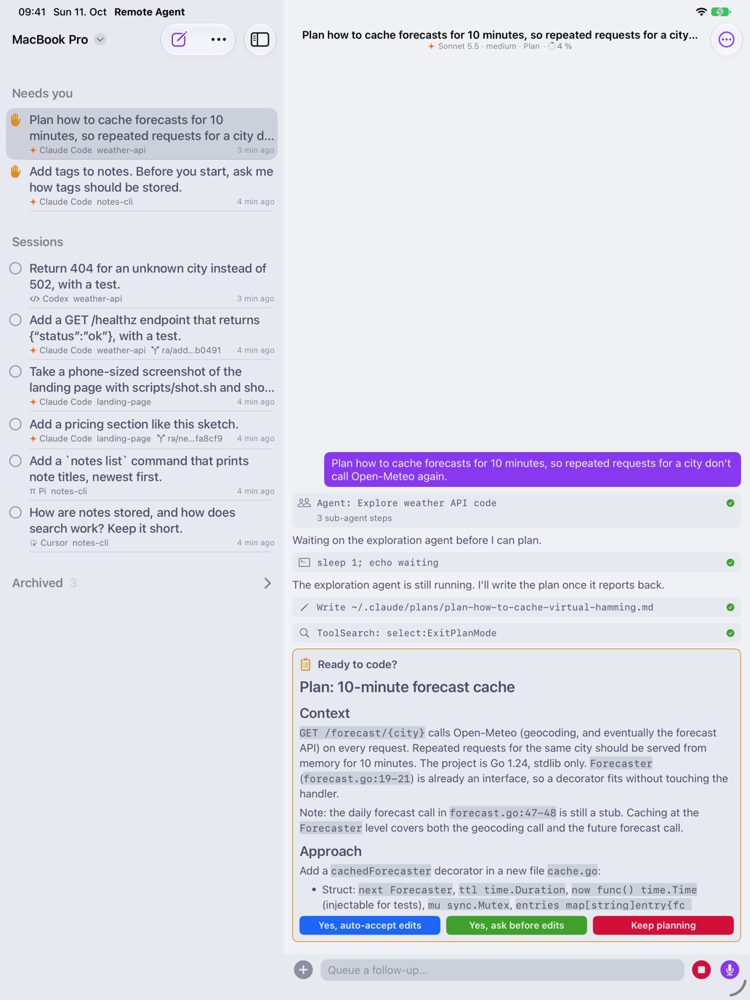
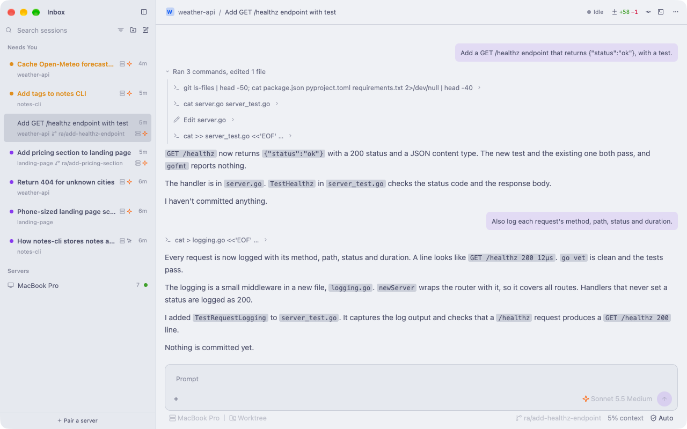

<p align="center">
  
</p>

# Remote Agent

Drive coding agents running on your computer from your iPhone, iPad, Mac, an Android phone or tablet, or a browser.

- **`rad`**: a Go server that runs on the dev machine. It spawns agent CLIs as child processes, normalizes what they do into one event model, persists it in SQLite, and serves it over a WebSocket.
- **Remote Agent**: a native app for iPhone, iPad and Mac: SwiftUI on iPhone and iPad, Rust with [GPUI](https://gpui.rs) on the Mac. Get it for iPhone and iPad on [TestFlight](https://testflight.apple.com/join/SHpGMtve), and for the Mac from [Releases](https://github.com/buldezir/remote-agent/releases). You pair it by QR code, or on the Mac by pasting a link. On iPad and Mac, one sidebar lists every server's sessions next to the one you have open; on iPhone, an Inbox tab lists them all, beside the Servers tab with each server's own. From the app you can:
  - start sessions in any project
  - pick up a session you started with `claude`, `codex` or `pi` in a terminal, and carry on from your phone
  - save a session's first prompt as a draft, and send it later from any device
  - watch agents stream their work
  - see each run of tool calls folded into one line, such as "Ran 4 commands, edited 3 files", which opens to show them
  - dictate prompts, in any of your keyboard languages
  - attach images to prompts, and see the ones agents return, such as screenshots
  - approve or deny tool calls
  - answer the agent's questions
  - review per-turn git diffs and revert them
  - commit a session's work, push its branch and open a pull request, with a message the system agent writes
  - see each session's pull request, its checks and review, on its row and in its header
  - fork a session after any of its turns, with the same agent or another, in a worktree with the files as they were then
  - let agents start and drive sessions of their own, with other agents, through rad's MCP tools
  - update rad and the agents, and sign an agent in again, without going to the computer
  - see how much of their plan's 5-hour and weekly limits Claude Code and Codex have used, and when they reset
  - get a notification on the Mac when a session needs you or finishes
  - see which sessions finished while you were away, marked unread until you open them
  - search what was said in every session on all your servers, and find text in the one you have open
  - rename a session, and rad keeps your name for it
- **Web client**: the same app for a browser, in `web/` (React and TypeScript). In a wide window it has the iPad's sidebar of every server's sessions. For now you run it from its dev server on your computer; see [Running the web client](#running-the-web-client).
- **Android app**: the same app, native, for Android 16 or later, in `android/` (Kotlin and Jetpack Compose). On a tablet, as on iPad, one sidebar lists every server's sessions next to the one you have open. See [Installing the app on Android](#installing-the-app-on-android).

<p>
  
  
  
  
  
</p>
<p>
  
  
</p>

More, including the web client, dark mode and the Server app: [docs/screenshots.md](docs/screenshots.md).

Supported harnesses:

| Harness | How rad talks to it |
|---|---|
| Claude Code | `claude --input-format stream-json --output-format stream-json --permission-prompt-tool stdio`: the same control protocol the Agent SDKs use |
| Codex | `codex app-server` (JSON-RPC over stdio) |
| Pi | `pi --mode rpc` (JSON commands and events over stdio) |
| Cursor, OpenCode, Gemini, Oh My Pi, … | [Agent Client Protocol](https://agentclientprotocol.com): `cursor-agent acp`, `opencode acp`, `gemini --acp`, `omp acp` (configurable) |

Prior art: [Happy](https://github.com/slopus/happy) (mobile client and relay for Claude Code) and [T3 Code](https://github.com/pingdotgg/t3code) (local server that owns agent processes, worktrees and checkpoints).

## Quick start

The server lives in `server/` and builds into `server/bin/rad`:

```bash
cd server
go build -o bin/rad ./cmd/rad
./bin/rad serve          # first run writes ~/.config/remote-agent/config.yaml and prints a pairing QR
```

Or download rad for Linux or macOS, arm64 or x86-64, from [Releases](https://github.com/buldezir/remote-agent/releases), unpack it and run `rad serve`.

On the phone, open Remote Agent and tap **Pair a server**, then scan the QR code. On the Mac, or in the simulator, paste the link that `rad pair` prints instead.

`rad serve` and `rad pair` list the agents that are ready, and any installed agent that still needs a login. The phone only sees agents installed on the server.

rad listens on all interfaces (`0.0.0.0:7421`). The pairing link tells the phone which addresses to try:

- **Tailscale (recommended):** the Tailscale address (100.x) is in the link by default, and WireGuard encrypts the traffic.
- **Same Wi-Fi:** run `rad serve --lan` / `rad pair --lan`, or set `lan = true` in the config, to add the LAN addresses too. Traffic on the LAN is plain HTTP.
- **Your own choice:** set `pair_urls` in the config to put exactly those addresses in the link, in that order, e.g. a Tailscale MagicDNS name or one specific LAN IP. Plain `http://` works with IP addresses, `.local` names and `*.ts.net`; any other host name needs `https://`.

To keep rad running in the background:

```bash
./bin/rad install-service          # --uninstall to remove
```

- **macOS:** a LaunchAgent that starts at login. Logs go to `~/Library/Logs/rad.log`.
- **Linux:** a systemd user unit, `remote-agent.service`. Read the logs with `journalctl --user-unit remote-agent -f`.
  - rad turns on lingering for your user, so it starts at boot and keeps running after you log out. Without polkit (as on a minimal Debian server) that needs root: run `sudo loginctl enable-linger $USER` first.
  - Run it from a login of that user, e.g. over SSH, not through `su` or `sudo`.

Both capture your current `PATH`, so rad finds the agent CLIs the way your shell does. Run `install-service` again after rebuilding rad, or after installing an agent CLI somewhere new.

On a Mac, the [Remote Agent Server app](#running-rad-as-a-mac-app) can run rad in the background instead, and lets you give agents the macOS permissions they need.

To remove rad completely, run `./bin/rad uninstall`. It lists everything first and asks before removing. It removes:
- the service
- the config
- the data: the database, logs and session worktrees (uncommitted changes in them are lost)
- the `refs/ra/*` checkpoints in your project repos

It keeps the session branches and the rad binary.

### Updating

```bash
rad update --check     # is there a newer release?
rad update             # install it
```

`rad update` downloads the newest release for this platform from GitHub and checks it against the release's `SHA256SUMS`. It runs the new binary once, then puts it in place of the one you ran and keeps the old one as `rad.old` next to it.
- **As the background service:** if `install-service` set up this binary, the service is restarted and `rad update` waits for the new version to answer. A restart interrupts running turns, so while any session is busy (a turn running, or an approval waiting) it stops before downloading and names them. Pass `--now` to go ahead anyway.
- **In a terminal:** restart `rad serve` yourself.
- **Development builds:** a build from source (`rad version` says `dev`) isn't replaced without `--force`.
- **Remote Agent Server app:** the app updates itself, and its rad, from its menu, below. `rad update` run as the app's rad, such as the `rad` command the app installs, has the app update itself without asking anyone at the Mac, then waits for rad to come back as the new version. As with the service, it stops first while a session is busy, unless you pass `--now`.
- **From the apps:** a server's **Server Settings…** updates rad too (see [Managing a server from the apps](#managing-a-server-from-the-apps)).

## Running rad as a Mac app

**Remote Agent Server** is a menu bar app that runs rad. rad and the agents it starts are the app's children, so macOS asks for their privacy permissions in the app's name, and you can grant them up front while you're at the Mac. Otherwise a prompt that comes up while you're driving an agent from your phone holds that agent until someone answers it at the Mac. The app also starts rad with the environment of your login shell, so it finds the agent CLIs.

1. Build it and copy it to /Applications. You need Go and Xcode; the build compiles rad into the app.

   ```bash
   (cd apple && xcodegen) && xcodebuild -project apple/RemoteAgent.xcodeproj -scheme RemoteAgentServer -configuration Release -derivedDataPath apple/build build
   cp -R "apple/build/Build/Products/Release/Remote Agent Server.app" /Applications/
   ```

   Run it from one place only: macOS treats each copy separately and can list both in System Settings.

   Or, on Apple silicon, download `Remote-Agent-Server-macOS-arm64.zip` from [Releases](https://github.com/buldezir/remote-agent/releases). It is signed with Developer ID and notarized, updates itself, and keeps its permissions across updates. Drag it into Applications on its own, not together with the client app: macOS runs apps dragged in together from a temporary copy, which can't update itself. If the app says it can't be updated, quit it and run `xattr -dr com.apple.quarantine "/Applications/Remote Agent Server.app"`.
2. Signing uses the team saved in `apple/Local.xcconfig` (step 3 for the iPhone). Without one, macOS forgets the app's permissions every time you rebuild it.
3. Open it. It runs rad with your usual config and opens **Permissions** the first time:
   - **Desktop, Documents and Downloads:** macOS asks once for each folder. **Full Disk Access** covers them and everything else, and is switched on in System Settings.
   - **Accessibility, Screen Recording and Automation of System Events:** for agents that click, type, take screenshots or run AppleScript. Other apps ask the first time an agent scripts them.
   - **Local Network:** for agents that reach other devices on your network. CLIs run from Terminal get this automatically; under the app, macOS asks. Your phone reaches rad without it.
   - **Developer Tools:** add the app under System Settings › Privacy & Security › Developer Tools, and programs your agents build skip Gatekeeper's checks.

   After turning on Full Disk Access or Screen Recording, choose **Restart rad** in the menu.

The menu shows whether rad is running, its addresses and the agents it found:
- **Pair a Device…** shows the pairing QR code.
- **Start at Login** replaces `rad install-service`. If that service is installed, the menu offers to remove it, since only one rad can serve a config at a time.
- **Open Log** opens `~/Library/Logs/Remote Agent Server/rad.log`.
- **Install rad Command…** puts `rad` on your PATH: it links `/usr/local/bin/rad` to the app's rad, asking for an administrator's password if that folder isn't yours. The link keeps working across updates. The item is gone once the link is there.
- **Check for Updates…**: the app updates itself, with the rad inside it, from this repository's releases. It checks once a day and downloads a newer release by itself; the menu then offers **Install … and Restart…**, and otherwise it installs when you quit the app. **Check for Updates…** shows what's new and installs it.
  - Installing restarts the app, and so rad. If that would interrupt a session, the app asks first. Choose **Later**, and the update installs when you quit the app, or when you choose **Install … and Restart…**.
  - **Server Settings…** in the apps installs it from your phone, and `rad update` from a terminal, over SSH too: rad asks the app, which installs without asking, as you aren't at the Mac. The apps warn you first about sessions it would interrupt, and `rad update` stops unless you pass `--now`.
  - Each release is signed like the last, so macOS keeps the app's permissions.
  - Builds from Xcode (version `0.1`) offer no updates.
- Quitting the app stops rad and its agents.

The `rad` CLI keeps working next to the app (`rad pair`, `rad devices`, `rad update`): **Install rad Command…** puts it on your PATH, and otherwise the app's copy is `/Applications/Remote Agent Server.app/Contents/MacOS/rad`.

## Installing the app on an iPhone or iPad

The quickest way is the beta on [TestFlight](https://testflight.apple.com/join/SHpGMtve). To build it yourself, you need an iPhone or iPad on iOS 27 or later, Xcode, an Apple ID and, for the first run, a cable.

- **Free Apple ID:** builds expire after 7 days; run from Xcode again to renew.
- **Paid Developer Program membership:** builds last a year.

1. In Xcode → Settings → Accounts, add your Apple ID.
2. Generate and open the project (commands here run from the repo root):

   ```bash
   (cd apple && xcodegen) && open apple/RemoteAgent.xcodeproj
   ```

3. Select the **RemoteAgent-iOS** target → Signing & Capabilities, and choose your team.
   - If Xcode says the bundle ID is taken, see step 4.
   - xcodegen regenerates the project and forgets this choice. Save the team in the gitignored `apple/Local.xcconfig` so it survives:

     ```bash
     grep -m1 -o 'DEVELOPMENT_TEAM = [A-Z0-9]*' apple/RemoteAgent.xcodeproj/project.pbxproj > apple/Local.xcconfig
     ```

4. If the bundle ID was taken, add `PRODUCT_BUNDLE_IDENTIFIER = com.yourname.remote-agent` to `apple/Local.xcconfig`, then run `xcodegen` again.
5. Prepare the device:
   1. Connect it, unlock it and tap **Trust**.
   2. Turn on Settings → Privacy & Security → **Developer Mode**. The switch appears once Xcode has seen the phone, and turning it on restarts the phone.
6. Pick the device as the run destination and press ⌘R.
   - With a free Apple ID, the first launch is blocked until you trust yourself as a developer: Settings → General → VPN & Device Management → your Apple ID → Trust.
   - After the first run, Xcode can also install over Wi-Fi.
7. Make sure the phone can reach the computer. Use Tailscale, or set `lan = true` for the same Wi-Fi (see Quick start).
8. Pair the phone:
   1. Run `server/bin/rad pair` on the computer. Add `--lan` if the phone will connect over Wi-Fi rather than Tailscale.
   2. In the app, tap **Pair a server** (or **+**) and scan the QR code. The Camera app can scan it too.
   3. Allow Local Network access when iOS asks.

## Running the Mac app

The Mac app is in `gpui/`, written in Rust with [GPUI](https://gpui.rs), Zed's UI framework. It runs on macOS 13 or later.

- **From a release:** download `Remote-Agent-macOS-arm64.zip` from [Releases](https://github.com/buldezir/remote-agent/releases). Like the Server app's release build, it is signed with Developer ID and notarized, and updates itself with Sparkle: **Remote Agent › Check for Updates…**, and once a day unless you turn that off in Settings › General › Updates. As with the Server app, drag it into Applications on its own; if it says it can't be updated, quit it and run `xattr -dr com.apple.quarantine "/Applications/Remote Agent.app"`.
- **From source:** you need Rust, Xcode's Metal toolchain (`xcodebuild -downloadComponent MetalToolchain`) and an Apple Development certificate in your login keychain (Xcode › Settings › Accounts › Manage Certificates), which keeps the pairing tokens readable from one build to the next.

  ```bash
  gpui/scripts/bundle.sh                    # Remote Agent Dev.app, installed in /Applications
  gpui/scripts/bundle.sh --release 0.12.0   # Remote Agent.app as a release builds it, in gpui/target/release
  ```

  The development build is an app of its own, **Remote Agent Dev**, with its own servers, so it sits in Applications beside a release; see [DEVELOPMENT.md](DEVELOPMENT.md#building).

Pair it: run `server/bin/rad pair --print-url`, and paste the link in **File › Pair a Server…**, or pass it at launch: `open -a "Remote Agent" --args "$(server/bin/rad pair --print-url)"`. Given an ssh host instead of a link, the same page installs rad on that computer and pairs with it. [gpui/README.md](gpui/README.md) lists what the app does and its shortcuts.

## Installing the app on Android

You need a phone or tablet on Android 16 or later.

- **From a release:** download `Remote-Agent-Android.apk` from [Releases](https://github.com/buldezir/remote-agent/releases) on the phone, open it, and allow installing apps from your browser when Android asks. Later releases install over it.
- **From source:** you need the Android SDK and JDK 17 or later; Android Studio brings both. Connect the phone with USB debugging on (Settings › System › Developer options), then:

  ```bash
  cd android && ./gradlew :app:installDebug
  ```

  The debug build is `dev.remoteagent.app.debug`, so it installs next to a release.

Pair it: run `server/bin/rad pair` on the computer (add `--lan` for Wi-Fi), then tap **Pair a server** (or **+**) › **Scan QR code**. Google Play services shows the scanner, so the app needs no camera permission. Without Play services, paste the link instead. A `remoteagent://pair` link opened on the phone also opens the pairing sheet.

On Android 17 or later, allow **Nearby devices** when the app first opens so it can reach servers over Wi-Fi. If you denied it, enable it in Settings › Apps › Remote Agent › Permissions, then return to the app. Tailscale connections can still work without this permission.

- **Addresses:** the app talks plain `http://` to rad at any address `rad pair` prints, not only IPs, `.local` names and `*.ts.net` as on iOS. Prefer Tailscale: on the LAN the traffic isn't encrypted.
- **Composer:** a hardware keyboard's Return sends and ⇧Return starts a new line. The terminal has a row of keys a phone keyboard lacks: esc, ctrl, tab and the arrows.
- **Dictation** uses the phone's speech recognizer, on the device where it can, in your keyboard languages.

## Running the web client

The web client in `web/` does what the apps do, in a browser. It needs Node.js 22 or later. For now it runs from Vite's server on your computer rather than from a host:

```bash
cd web && npm install && npm run dev                          # serves http://localhost:5173
server/bin/rad pair --web http://localhost:5173 --print-url    # open the link it prints, then press Pair
```

Or open http://localhost:5173, choose **Pair a server** and paste the link that `rad pair` prints. The page keeps each server's token in the browser's local storage.

- **Which pages may use rad:** a browser tells rad which page a request comes from. rad answers only pages on the origins in its config's `web_origins`, which by default are pages on `localhost` and `127.0.0.1`. Add an origin there, such as `"https://agents.example.com"` or `"my-mac.tail1234.ts.net:*"`, to open the client from another address.
- **HTTPS:** a page served over `https://` can't call rad on plain `http://`. Serve the client over `http://` too, or put rad behind HTTPS, for example with `tailscale serve`.
- **Composer:** Return sends, ⇧Return starts a new line, and ⌘. or Ctrl+. stops the agent. You can paste or drop images. Dictation uses the browser's speech recognizer where it has one (Chrome, Edge, Safari).
- **Sidebar:** in a wide window it lists every paired server with its sessions, those waiting for you first. Click a server's name to hide or show its sessions; the page remembers which you hid. Hover the name for + (a new session on that server) and ⋯ (reconnect, rename or remove it).
- `npm run build` writes a static site to `web/dist`, which any web server can serve.
- **Docker:** `web/Dockerfile` serves the client with nginx on port 8080, and `web/compose.example.yaml` runs it. [`.github/workflows/web-image.yml`](.github/workflows/web-image.yml) pushes the image to `ghcr.io/buldezir/remote-agent-web`: `edge` from main, `latest` and the version from a `v*` tag. Add the address you open it at to rad's `web_origins`, such as `"my-server.local:8080"`, then pair with `rad pair --web http://my-server.local:8080`.

## Using it

- **New session:**
  1. Pick a project folder; you can browse anything under `roots` from the config.
  2. Pick an agent, a model, an effort and a permission mode. Claude Code and Codex offer three: **Yolo**, the default, which never asks; **Plan**, which only reads and proposes a plan; and **Auto**, where a reviewer approves the safe actions (Claude Code's classifier, Codex's `auto_review` agent) and asks you about the rest. The app remembers what you last started each agent with. Beside Claude Code and Codex, a gauge shows how much of their plan's limits they've used (see [Usage limits](#managing-a-server-from-the-apps)).
  3. In a git project, choose where the agent works (**Work in**): the **Project folder**; a **New worktree** in `~/Library/Application Support/remote-agent/worktrees/…`, on a new branch (named for you, or as you write it, from the branch you pick) or on an existing branch that no checkout has; or one of the project's **existing worktrees**: another session's, one you made with `git worktree add`, or an agent's own, such as Claude Code's in `.claude/worktrees/`. Sessions can share a worktree. Archiving or deleting a session with its worktree removes it only if rad made it and no other session works there.
  4. Write the first prompt, or leave it empty to open the session and write it there.
- **Images:** the + beside the prompt attaches photos, image files or the clipboard's image. You can also drop images on the session. The app scales them to 2048 px and strips their metadata before uploading.
  - Claude Code, Codex, Pi and ACP agents that accept images see them directly. Other ACP agents get the files' paths on your computer.
  - Images agents produce show up in the transcript: an MCP tool's screenshot, an image file the agent read, or Codex viewing or generating one. Tap one to open it in Quick Look: zoom in, share it or mark it up. On iPhone and iPad it fills the screen; on the Mac it opens in a window you can resize.
  - Asked for a screenshot, an agent can show it without reading it, which would cost context. rad tells every agent that you aren't at the computer, and to put an image file in its reply as a Markdown image with its path, such as ``. rad then sends the file to the app, which shows it in the reply. Claude Code and Pi get this in their system prompt, Codex as developer instructions, and ACP agents before the first prompt.
  - rad keeps every image in `<data>/images`, named by its content hash.
- **Approvals:** cards appear inline. The buttons come from the agent itself, e.g. *Allow*, *Allow all edits this session*, *Deny*. When denying, you can give the agent a reason.
  - Pi doesn't ask before running tools. Oh My Pi asks only clients that run its file and terminal tools for it, which rad doesn't, so expect no approvals from it either.
  - Pi extensions can still ask: their yes/no and multiple-choice dialogs show up as cards, e.g. from Pi's example `permission-gate.ts`. The app can't answer their free-text prompts yet, so those are cancelled.
- **Questions and plans:** Claude's `AskUserQuestion` and `ExitPlanMode` show up as choice and plan cards.
- **Changes:** rad snapshots the workspace before and after every turn into hidden git refs (`refs/ra/cp/…`), without touching your index or HEAD. You can view each turn's diff or the whole session's.
- **Revert:** in worktree sessions you can revert to before any turn. The agent is told about it on the next prompt.
- **Fork:** a session's ⋯ menu has *Fork…*, which starts a new session that goes on after one of its turns, the last one unless you pick another. The fork starts with the transcript up to that turn; the original stays as it is.
  - **Agent:** the same agent picks up its own conversation, cut after that turn: Claude Code and Codex copy it themselves. Pick another agent, or one that can't copy its conversation (Pi, ACP agents), and it gets the conversation as a transcript with the fork's first prompt.
  - **Files:** in a git project, *Work in* › *New worktree* gives the fork its own branch with the files as they were after that turn, uncommitted changes included. *Project folder* works in the project folder as it is now, and for a session in a worktree, *This session's worktree* works beside it there, on its branch, with the files as they are now.
- **Continue a terminal session:** the new session form has *Continue a terminal session…* for Claude Code, Codex and Pi. It lists the sessions that agent ran in the chosen project's folder on its own, such as `claude` in a terminal at your desk, newest first, with their names (the agent's, or yours, else the first prompt), how many messages they have and when they were last active. Pick one and it opens as a session in the app, with its conversation so far, and your next prompt goes on with it, as `claude --resume` would.
  - The agents keep their sessions in their own folders: Claude Code in `~/.claude/projects/`, Codex in `~/.codex/sessions/`, Pi in `~/.pi/agent/sessions/`. rad reads them where `CLAUDE_CONFIG_DIR`, `CODEX_HOME` or `PI_CODING_AGENT_DIR` puts them, in a harness's `env` in the config or in rad's own environment.
  - The list leaves out sessions rad started or already picked up, sub-agents' sessions, and sessions without a reply yet.
  - A session the agent wrote to in the last minute may still be open in the terminal: the list warns about it, and so does the session once it's picked up. Quit it in the terminal before you prompt it from the app, or the two will write over each other.
  - The session works in the project folder, where the agent keeps it. Its earlier turns have no diffs, as rad didn't see them happen, but you can fork after them.
- **Commit:** in a git project, a session's ⋯ menu has *Commit…*, which lands the agent's work from wherever you are: it commits what the agent changed, in its folder (its worktree, for a worktree session), and, as you choose, pushes the branch and opens a pull request on GitHub. The Changes view has it too, and on the Mac the Session menu (⌥⌘C), with Rename…, Changes and Fork….
  - The sheet lists the files and a commit message the system agent wrote from the diff, which you can edit. Without a system agent, the message is the session's title. Pick *Commit only*, *Commit & push* or *Commit, push & open PR*; the apps remember your choice. On the repository's default branch, such as `main`, a pull request has nowhere to go, so the sheet offers only the first two and says why.
  - Each step shows as it goes: *Commit* stages everything and commits it, running the repository's hooks (it's skipped when there's nothing to commit); *Push* pushes the branch to `origin`, or to the remote it already tracks a branch of its own name on, and sets it as the branch's upstream; *Open a pull request* runs GitHub's [`gh`](https://cli.github.com) on the computer, into the branch the worktree was made from (else the repository's default branch), with a title and description the system agent writes from the branch's commits. *Open Pull Request* then opens it on your phone. If one is open for the branch already, the push updates it, and the sheet shows that one.
  - It needs a remote to push to, and `gh` installed and signed in (`gh auth login`) for the pull request; otherwise the step says so. git and `gh` can't ask for a password or passphrase there, as nobody is at the computer to answer: they fail instead, so push over SSH with a key in the agent, or with a credential helper that remembers it.
  - It waits until the agent's turn ends, and prompts you send while it commits wait for it. The transcript notes what was committed, pushed and opened, and the agent hears of it with your next prompt.
- **Pull requests:** a session whose branch has a pull request on GitHub shows it on its row and in its header, as `#42` coloured by its state (open green, draft grey, merged purple, closed red), with its checks (passing, failing or running) and review; tap it in the header to open it. rad finds it with `gh` on the computer, whoever opened it: you, the agent, or a commit from the apps. It looks a few seconds after each turn or commit, when the branch changes and when you open the session, and every few minutes while an app is connected; it only asks GitHub about branches that are pushed and aren't the default branch. Without `gh` signed in, sessions show none.
- **Agents that start sessions:** the agents rad runs get its MCP tools (`list_projects`, `list_agents`, `list_sessions`, `start_session`, `send_prompt`, `read_session`, `wait_for_session`, `stop_session`, `rename_session`, `fork_session`), so you can ask one to hand work to other agents, or to run it in parallel, and to report back. The sessions it starts show up in the apps like any other, beginning with a note of who started them, and their approvals and questions come to you: the agent can't answer them.
  - **Which agent:** unless the agent names one, a session it starts gets the default agent, model and effort from Server Settings (see [Managing a server from the apps](#managing-a-server-from-the-apps)), and without one, the agent's own.
  - **Permissions:** a session an agent starts gets that agent's own permission mode with the same agent, or else the other agent's default mode, which for Claude Code and Codex is Auto, not Yolo. An agent can't start one that asks you less than it does. Sessions started this way can start others, three deep at most.
  - **Which agents:** Claude Code and Codex reach the tools over HTTP, ACP agents through `rad mcp`; Pi has no MCP client. The tool calls show in the session like any other, and the agent may ask you first, as it does for other tools.
  - **Agents you run yourself:** `claude mcp add rad -- rad mcp` (or `codex mcp add rad -- rad mcp`) gives Claude Code or Codex in a terminal the same tools on the rad that serves this config. `rad mcp` adds itself as a device, "rad mcp", the first time; `rad devices revoke` takes it away. A device's tools start sessions in any mode.
  - `mcp: false` in the config leaves the tools out.
- **Commands:** type `/` in the composer for the slash commands and skills the session's agent has, and send one as a prompt. Remote Agent adds `/compact`, which has the agent summarize the conversation so far to free up context, for Claude Code, Codex and Pi. The transcript marks it with *Context compacted*, and the context gauge drops.
  - Typing `/compact` as a prompt does the same, and `/compact <instructions>` tells Claude Code or Pi what the summary should keep; Codex takes no instructions for it.
  - Claude Code runs it itself. rad runs it with Codex's and Pi's own compaction, since they don't take `/compact` in a prompt.
- **Skill suggestions:** type `/` in a session’s composer to search commands and skills by name or description. Select a suggestion, add instructions, then send. Android, iOS, Mac and web use the skills available to that session’s workspace on rad’s machine: Codex skills, Claude Code user-invocable skills, and Pi’s `/skill:name` commands. Discovery starts the agent process when needed but sends no prompt. Claude’s list refreshes when its agent process restarts.
- **Terminal:** a session's ⋯ menu opens a shell on your computer, in the session's folder (its worktree, for a worktree session). It's your login shell, in a real terminal, so `git`, `vim`, `htop` and the agents' CLIs work as they do at the computer.
  - The shell keeps running when you close the terminal, switch apps or lose the connection, and reopening it picks up where it was: rad keeps its last 256 KiB of output. It ends when you `exit` it or choose *Close Shell*, when the session is archived or deleted, or when rad stops. Each session has one shell, shared by all your devices.
  - On the Mac, iPad and the web client in a wide window, Settings › Terminal picks where it opens: instead of the messages, below them, or in a sidebar on the right. On an iPhone, or in a narrow window, it takes the place of the messages.
  - On the Mac and in the web client, text you select in it with the mouse goes straight to the clipboard. Settings › Terminal › Copy on select turns that off.
  - ⌘J or ⌘` shows and hides it, with a keyboard on iPad too; hiding it puts you back in the prompt. In the web client Ctrl works as well, except inside the terminal, where Ctrl+J and Ctrl+` go to the shell.
  - On iPhone and iPad, the bar above the keyboard has Esc, Ctrl, Tab and the arrow keys; the web client shows similar keys on touch screens.
- **Notifications:** the Mac app and the web client tell you when a session on any server needs you (an approval, a question or a plan), finishes its turn, or fails. Nothing comes for the session the window shows while it's in front. A click opens the session, and a notification that a session needs you goes away once you answer it, on any device.
  - On the Mac they're on from the start, once you allow them; Settings › Notifications turns them off. They come while the app runs, even with its window behind others.
  - In the web client, turn them on in Settings › Notifications, and the browser asks to allow them. They come while the page is open, in any tab or window, and need the page on `localhost` or https: browsers have no notifications on plain http elsewhere, such as a Tailscale address.
  - The apps go by a session's status, so a turn that ended with an error from the agent, or that you stopped, also shows as finished.
- **Search:** the field atop the sidebar searches every session on every server you're connected to: your prompts, the agents' replies, the titles and commands of their tool calls, plans and questions, and the sessions' titles and branches. On iPhone and Android phones it's in the Inbox tab; in the Columns layout it's atop the list of sessions. ⇧⌘F (Ctrl+Shift+F in a browser or on Android) goes to it.
  - Each session shows once, with the part that matches best and its words highlighted, its project, agent and age, and how many of its messages match. Open it, and the session scrolls to that part, which flashes.
  - Every word you type must be there, as the start of a word (`redir` finds *redirect*), or a "quoted phrase" as it is; case and accents don't matter. Sessions that match well come first, and among them the recent ones.
  - Archived sessions are included, marked *Archived*, unless you turn off *Include archived*.
  - The agents' thinking and their tools' output aren't searched: they're long, and would bury the conversation.
  - rad keeps its index as it goes. The first time a rad with search starts, it indexes the sessions it has in the background, newest first: a few thousand sessions take about half a minute, and results meanwhile say some may be missing.
- **Tool calls:** the tool calls an agent makes between two messages, and its thinking between them, fold into one line that sums them up, with each kind's icon: *Ran 4 commands, edited 3 files, read 2 files, searched 1 time*. Files count once each, however often they were read or edited. Tap or click the line to open it to the calls, each as before, and again to fold them; a session that stays open remembers which you opened.
  - A call on its own stays as it is, and so does one that waits for your approval, failed, or shows an image, between the folded lines.
  - While the agent works, the calls it is making show open, with a spinner on their line, so that you can follow along; they fold once it replies or its turn ends.
  - Find in a session shows the fold that holds the match it's on open, and leaves it open when you close it; opening a search result opens the fold that holds what it found.
  - Settings › Transcript › *Group tool calls* turns it off.
- **Find in a session:** ⌘F (Ctrl+F in a browser or on Android with a keyboard), or *Find in Session* in the session's ⋯ menu, finds text in the open session, the same parts of it that search looks at. It counts the messages that match and highlights them, starting at the newest: Return or the ⌄ button goes to the next, ⇧Return or ⌃ back to the one before (⌘G and ⇧⌘G on the Mac and in a browser), and Esc or Done closes it.
- **Unarchive:** *Unarchive*, in an archived session's row menu (or its ⋯ menu in the app), brings it back to the lists, where it takes prompts again and its agent picks up its conversation. A prompt you write in an archived session asks *Unarchive session?* first, then sends it. A worktree deleted with the archive is checked out again from its branch, which archiving keeps; its earlier turns no longer have diffs, since archiving drops their checkpoints.
- **Rename:** *Rename…*, in a session's ⋯ menu or a session row's menu (right-click, or a long press on a phone), gives a session a name of your own. rad names sessions from their first prompt, and the system agent a few seconds later; once you rename one, neither touches its name again, and a fork of it keeps the name, with " (fork)". Leave the name empty to hand it back: the session takes its first prompt's first line again, which the system agent then names anew, from the work done so far once the agent has had a turn. Renaming leaves the session where it is in the lists, every device shows the new name, and search finds the session by it.
- **Unread sessions:** a session whose turn ended, or that started waiting for you, while you weren't looking at it shows a dot in place of its empty circle, and its title in bold. So does its project's row, and a server's name while its sessions are hidden. Opening the session in a window that's in front clears the dot on all your devices, and takes back its notification. rad keeps the mark, so it waits for you until you look, on whichever device.
- **Connection:** when a server can't be reached, the apps try five times, over about 15 seconds, then stop and show why. Retrying, opening the server, or a click on its name in the sidebar (on iPad, the Mac, an Android tablet or a wide browser window) tries again, and so does coming back to the app.
- **Stop:** this interrupts the current turn. *Force stop* kills the agent process. Idle agents are stopped after `idle_timeout` and resume transparently on the next prompt.
- **Queued prompts:** a prompt sent while the agent works waits, marked *Queued*, and goes out when the turn ends. *Send now* under it stops the turn and sends that prompt at once, ahead of any others waiting, and *Cancel* takes it out of the queue, unsent. Stop cancels them all.
  - *Steer*, with Claude Code, Codex, Pi and the fake agent, adds the prompt to what the agent is doing, without stopping it: the agent reads it at its next step, such as after the command it runs, and goes on in the same turn, where the prompt now shows. ACP agents can't take one, so they offer only *Send now*, and neither do slash commands, which run as prompts of their own. On a keyboard, ⇧⌘Return (Ctrl+Shift+Enter in a browser or on Android) sends what you typed straight into the turn.
- **Text size:** Settings has two sizes: one for the interface, such as lists and labels, and one for messages: your prompts, the agent's replies and its tool calls. On the Mac it is under Remote Agent › Settings… (⌘,). On iPhone, open the ⋯ menu in the Inbox, tap the gear on the server list, or open a server's ⋯ menu; on iPad, open the ⋯ menu above the sidebar. On iOS the interface follows the system's text size until you turn off **Match System**.
  - On the Mac, Settings also picks the messages' font, from the system font's designs or any installed family, and a code font from the installed fixed-width ones. The code font is used for code in messages, tool calls and diffs.
- **Server Settings:** see [Managing a server from the apps](#managing-a-server-from-the-apps).
- **Colours:** the apps use [Catppuccin](https://catppuccin.com): Frappé in dark mode, Latte in light mode, with mauve as the accent. They follow the system's appearance, or Settings › Theme keeps them light or dark.

## Managing a server from the apps

On Mac and in wide iPad, Android and web windows, **Settings → Servers** lists saved servers and their connection status. Select one to reconnect, remove it, or manage rad and its agents; **Add Server** pairs another computer. The sidebar's **Server Settings…** shortcut opens that server in Settings. On small screens, **Server Settings…** stays in the server's ⋯ menu.

- **rad:** its version, and whether a newer release is out. **Update to …** installs it, and rad restarts: in place, as the same process (so a background service carries on), or, under the Remote Agent Server app, with the app. The apps reconnect by themselves. A restart interrupts the turns that run, so the apps say which sessions are busy and ask first.
  - A development build, or a rad that can't replace its own binary (in a folder that isn't yours, or inside an app bundle without the app), says so instead.
- **Agents:** each one's version, and whether it's signed in. **Update** runs the agent's own updater on the computer (`claude update`, `codex update`, `pi update`, `cursor-agent update`, `opencode upgrade`) and shows what it printed.
  - **Sign In** shows when an agent isn't signed in, and **Sign In Again** in its ⋯ menu otherwise. It runs the agent's sign-in on the computer (`claude auth login`, `codex login --device-auth`, `cursor-agent login`) without opening a browser there, and shows its sign-in page as a button: open it on your phone. Claude's page then gives you a code to paste back in the app; Codex shows a code to enter on its page; Cursor needs nothing more.
  - rad can't always tell that a login expired. When a turn fails because the agent isn't signed in, the agent shows as signed out until it signs in again or a turn of its works.
  - `update` and `login` in the config replace these commands, or add them for an agent without one (see [Configuration](#configuration)).
- **Usage limits:** under Claude Code and Codex, how much of their plan's usage limits the account has used, such as *5h 34% · week 61%*: the 5-hour window and the week. It turns amber from 80% and red once a limit is reached. Hover over it, or tap it, for when each window resets, the plan, extra usage, and how old the figures are. The new session form shows the same gauge beside the agent you pick.
  - Claude Code reports them with each request it makes, so they show once it has run a turn, and stay as they were between turns. rad asks Codex itself when it starts, when an app connects, and every 10 minutes while one is connected, besides what Codex reports at the end of each turn. rad keeps the last figures, so they show after a restart too, with their age. Pi and ACP agents don't report any.
  - When an agent refuses a turn for its limit, the turn fails, and the session says which limit, and when it resets: *5h limit reached · resets in 2h 14m*.
- **New Sessions:** the agent, model and effort that new sessions start with, on every device: the New Session form begins with them, and so do the sessions agents start with rad's MCP tools unless they choose their own. Pick another agent in the form and it begins with the model and effort you last used with it. With **Last Used**, each device begins with the agent it used last, and an agent's sessions with its own agent. The permission mode stays each device's own choice.
- **System Agent:** the agent and model that name new sessions. From the first prompt, it gives the session a short title and its worktree a branch name such as `ra/fix-login-redirect`, a few seconds after the session starts with names taken from the prompt. After the session's first and third turns, it names the session again from the work so far (the prompts, the end of the agent's latest reply and the files it changed), since a first prompt such as "look at this" often says little; it keeps a title that still fits. A title or branch you chose is kept, and so is a name you give the session later with *Rename…*. It also writes the messages of the commits you make from the apps, from their diffs, and the titles and descriptions of their pull requests. Pick a small, fast model, such as Claude's Haiku. With **None**, a session's title is its prompt's first line, and a commit's message is the session's title.
  - The calls leave nothing with the agent: no session, no history, no tools. Claude Code runs `claude -p --no-session-persistence --safe-mode --tools ""`, Codex `codex exec --ephemeral` in a read-only sandbox, and Pi `pi --print --no-session --no-tools`, each in an empty folder that rad removes afterwards. ACP agents can't be the system agent, as ACP has no such call.

## CLI

```
rad serve [--lan] [--fake] [-v]   run the server (--fake adds a scripted test harness)
rad pair [--lan] [--print-url]    new single-use pairing code (10 min) and the agents that are ready; --lan adds LAN addresses to the link
rad pair --web <url>              also a link that opens the web client at <url> to pair it
rad devices                       list paired devices
rad devices revoke <id-prefix>    revoke one; its open connections close within 30s
rad install-service [--uninstall]  run rad in the background (launchd on macOS, systemd on Linux)
rad update [--check] [--now]      install the latest release over this rad and restart its service
rad uninstall [--yes]             remove the service, config, data, worktrees and checkpoints
rad mcp                           rad's MCP tools on stdio, for an agent you run yourself (claude mcp add rad -- rad mcp)
rad debug run --harness claude --cwd DIR [--mode M] [--model M] [--effort E] [--worktree] [--approve] [--diff] "prompt"
rad debug prompt [--steer] <sessionId> "…"  follow-up turn, streamed to the terminal; --steer adds it to the running turn
rad debug call <method> '{json}'  raw RPC (see protocol/PROTOCOL.md)
```

## Configuration

`~/.config/remote-agent/config.yaml`. Data lives in `~/Library/Application Support/remote-agent` on macOS and `~/.local/share/remote-agent` on Linux. Set `RAD_HOME=/some/dir` to keep the config and data together, e.g. for tests.

```yaml
name: Work laptop               # what the app calls this server after pairing (default: host name)
port: 7421
lan: false                      # also put LAN addresses in the pairing link
# pair_urls: [my-mac.tail1234.ts.net, 192.168.1.20]   # or list the link's addresses yourself
                                # (bare hosts get http:// and the port; also host:port, https://…)
# listen: ["127.0.0.1:7421", "100.101.102.103:7421"]  # bind only these instead of 0.0.0.0
# web_origins: ["localhost:*", "127.0.0.1:*"]          # web pages that may use rad (this is the default; [] for none)
roots: [~/projects]             # what the phone may browse and add as projects ("~" in quotes for home itself)
idle_timeout: 30m
# mcp: false                    # leave rad's MCP tools, which start and drive sessions, out of the agents
acp:                            # any ACP agent can be added here
  - {id: cursor,   name: Cursor,   command: cursor-agent, args: [acp]}
  - {id: opencode, name: OpenCode, command: opencode,     args: [acp]}
  - {id: gemini,   name: Gemini,   command: gemini,       args: [--acp]}
  - {id: omp,      name: Oh My Pi, command: omp,          args: [acp]}
harness:
  claude: {command: claude}     # optional: args: [...], env: {KEY: value}
  codex: {command: codex}
  pi: {command: pi}             # e.g. args: [-e, /path/to/extension.ts] to load an extension
```

Each agent, built in or ACP, also takes `update` and `login`: the commands the apps run to update it and to sign it in again, such as `update: [npm, i, -g, "@google/gemini-cli@latest"]`. They replace the built-in ones; `[]` turns one off. Cursor and OpenCode have them built in, as `command` names them.

Unknown keys are errors, so a typo stops rad with the line number rather than being ignored.

## Security model

- A paired device can make agents run arbitrary commands on your machine, and open a shell there, as the user rad runs as. Treat device tokens like SSH keys. Under the Server app, that shell has the permissions you gave the app.
- rad listens on all interfaces, but every request except pairing needs a device token. To keep it off other networks entirely, set `listen` to loopback and your Tailscale address.
- Pairing codes are single-use and expire after 10 minutes.
- Tokens are 256-bit random values. Only their SHA-256 hash is stored, and the phone keeps the token in the Keychain. The Android app keeps it encrypted with a key in the Android Keystore, and leaves it out of backups. The web client keeps it in the browser's local storage, for its origin only.
- Browsers send the origin of the page making a request. rad answers browsers only from the origins in `web_origins`, so another site you visit can't use rad. The apps aren't browsers and aren't affected.
- Revoking a device closes its live sockets.
- The phone can browse and add only folders under `roots`.
- Permission modes are enforced by each agent itself. rad auto-approves only for Codex, when you switch a session to Yolo during a turn: Codex keeps a turn's policy to its end, so rad answers that turn's requests as Yolo would have.
- New sessions start in Yolo, so agents edit files and run commands without asking. Choose Auto or Plan in the New Session form for a session that should ask.
- Each session's agent gets a token of its own for rad's MCP tools, which lapses when the session is archived or deleted, or rad restarts. Claude Code and Codex read it from their environment, not their command line. With it, the agent can start and drive sessions, but not answer their approvals, nor start one in a mode that asks less than its own.
- Pi has no permission modes: it runs tools without asking.

## Development

The repository's layout, the tests, the scripted agent for trying the UI, and how releases are made: [DEVELOPMENT.md](DEVELOPMENT.md).
