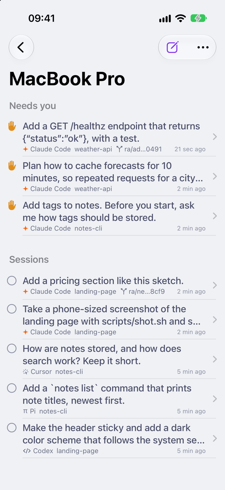
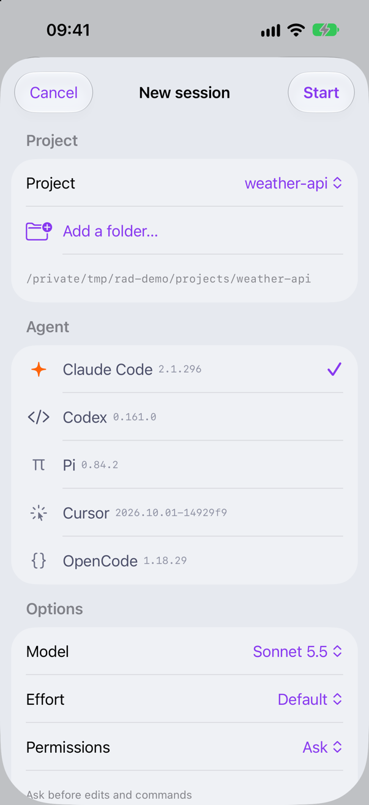
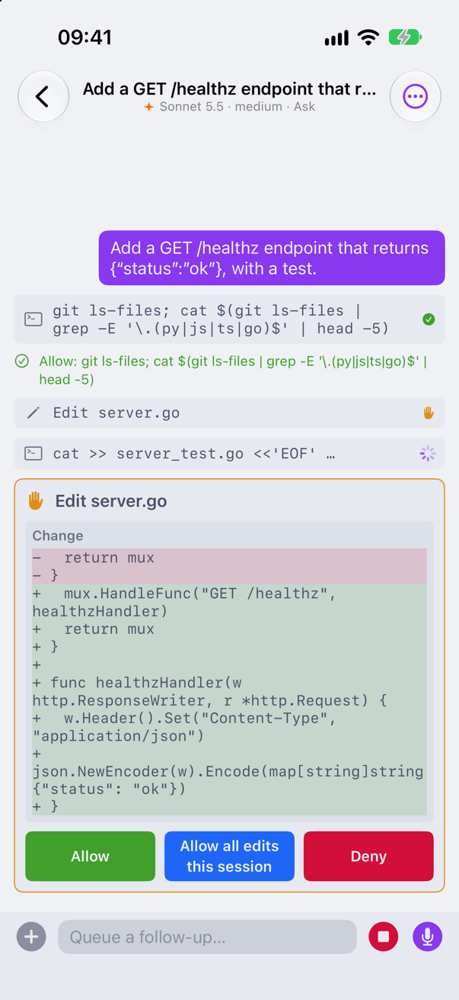
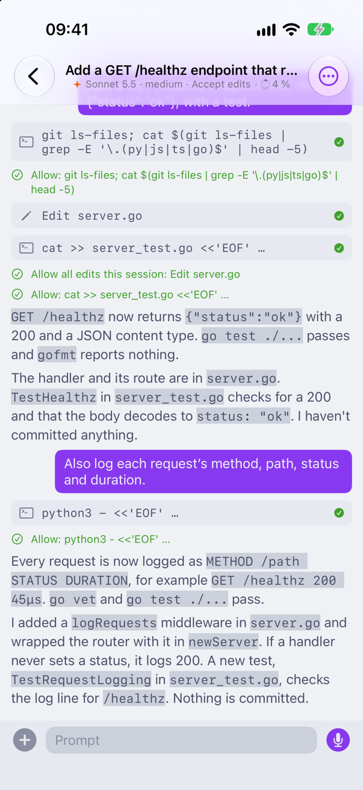
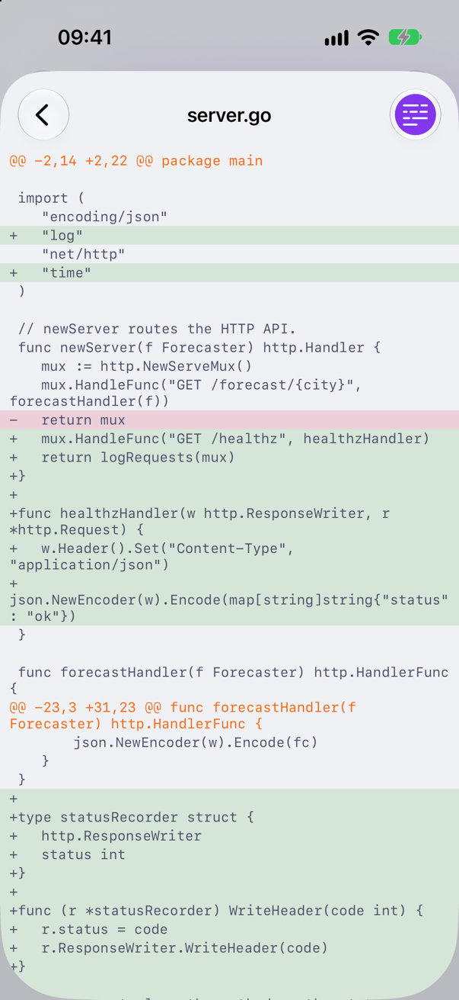
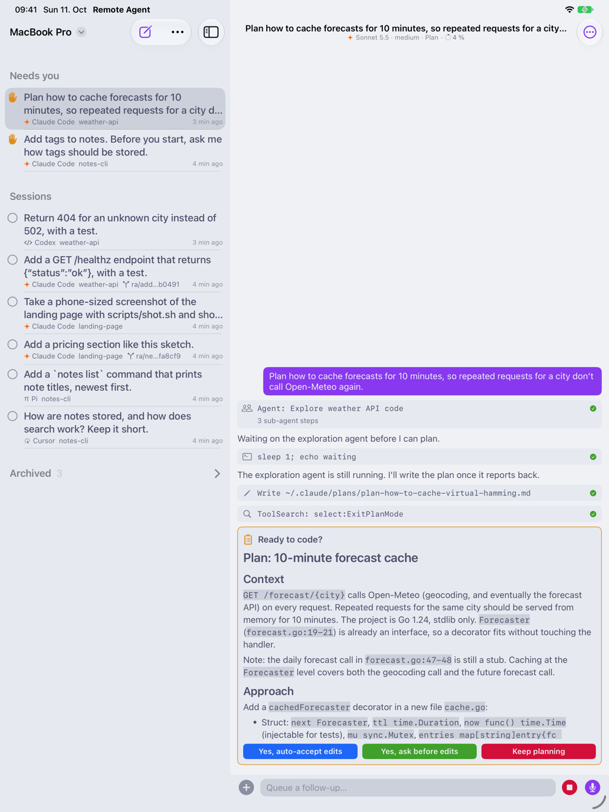
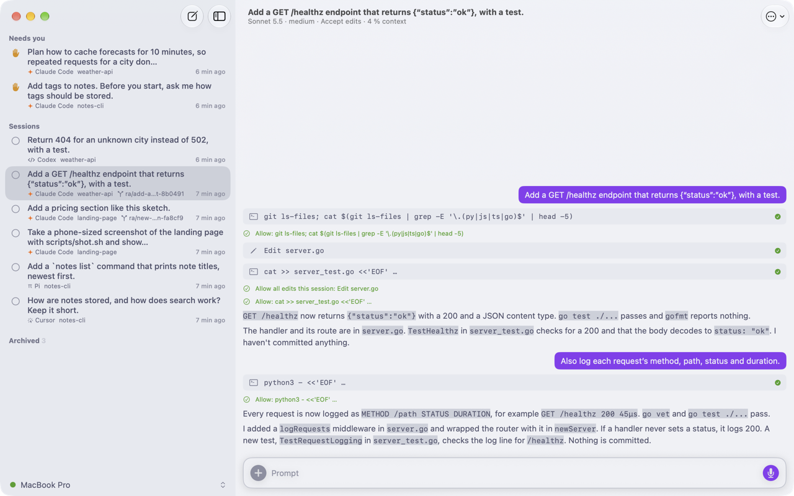

# Remote Agent

Drive coding agents running on your computer from your iPhone, iPad, Mac, an Android phone or tablet, or a browser.

- **`rad`**: a Go server that runs on the dev machine. It spawns agent CLIs as child processes, normalizes what they do into one event model, persists it in SQLite, and serves it over a WebSocket.
- **Remote Agent**: a native SwiftUI app for iPhone, iPad and Mac. Get it for iPhone and iPad on [TestFlight](https://testflight.apple.com/join/SHpGMtve). You pair it by QR code, or on the Mac by pasting a link. On iPad and Mac, one sidebar lists every server's sessions next to the one you have open; on iPhone, an Inbox tab lists them all, beside the Servers tab with each server's own. From the app you can:
  - start sessions in any project
  - save a session's first prompt as a draft, and send it later from any device
  - watch agents stream their work
  - dictate prompts, in any of your keyboard languages
  - attach images to prompts, and see the ones agents return, such as screenshots
  - approve or deny tool calls
  - answer the agent's questions
  - review per-turn git diffs and revert them
  - update rad and the agents, and sign an agent in again, without going to the computer
  - get a notification on the Mac when a session needs you or finishes
  - see which sessions finished while you were away, marked unread until you open them
- **Web client**: the same app for a browser, in `web/` (React and TypeScript). In a wide window it has the iPad's sidebar of every server's sessions. For now you run it from its dev server on your computer; see [Running the web client](#running-the-web-client).
- **Android app**: the same app, native, for Android 16 or later, in `android/` (Kotlin and Jetpack Compose). On a tablet, as on iPad, one sidebar lists every server's sessions next to the one you have open. See [Installing the app on Android](#installing-the-app-on-android).
- **`ra`**: a terminal client for the rad on the same machine, in Go with Bubble Tea, for when you'd rather stay in a terminal, or reach the computer over SSH. See [The terminal client](#the-terminal-client).

<p>
  
  
  
  
  
</p>
<p>
  
  
</p>

More, including the web client, dark mode and the Server app: [docs/screenshots.md](docs/screenshots.md).

Supported harnesses:

| Harness | How rad talks to it |
|---|---|
| Claude Code | `claude --input-format stream-json --output-format stream-json --permission-prompt-tool stdio`: the same control protocol the Agent SDKs use |
| Codex | `codex app-server` (JSON-RPC over stdio) |
| Pi | `pi --mode rpc` (JSON commands and events over stdio) |
| Cursor, OpenCode, Gemini, Oh My Pi, … | [Agent Client Protocol](https://agentclientprotocol.com): `cursor-agent acp`, `opencode acp`, `gemini --acp`, `omp acp` (configurable) |

Prior art: [Happy](https://github.com/slopus/happy) (mobile client and relay for Claude Code) and [T3 Code](https://github.com/pingdotgg/t3code) (local server that owns agent processes, worktrees and checkpoints).

## Quick start

The server lives in `server/` and builds into `server/bin/rad`:

```bash
cd server
go build -o bin/rad ./cmd/rad
./bin/rad serve          # first run writes ~/.config/remote-agent/config.yaml and prints a pairing QR
```

Or download rad for Linux or macOS, arm64 or x86-64, from [Releases](https://github.com/buldezir/remote-agent/releases), unpack it and run `rad serve`.

On the phone, open Remote Agent and tap **Pair a server**, then scan the QR code. On the Mac, or in the simulator, paste the link that `rad pair` prints instead.

`rad serve` and `rad pair` list the agents that are ready, and any installed agent that still needs a login. The phone only sees agents installed on the server.

rad listens on all interfaces (`0.0.0.0:7421`). The pairing link tells the phone which addresses to try:

- **Tailscale (recommended):** the Tailscale address (100.x) is in the link by default, and WireGuard encrypts the traffic.
- **Same Wi-Fi:** run `rad serve --lan` / `rad pair --lan`, or set `lan = true` in the config, to add the LAN addresses too. Traffic on the LAN is plain HTTP.
- **Your own choice:** set `pair_urls` in the config to put exactly those addresses in the link, in that order, e.g. a Tailscale MagicDNS name or one specific LAN IP. Plain `http://` works with IP addresses, `.local` names and `*.ts.net`; any other host name needs `https://`.

To keep rad running in the background:

```bash
./bin/rad install-service          # --uninstall to remove
```

- **macOS:** a LaunchAgent that starts at login. Logs go to `~/Library/Logs/rad.log`.
- **Linux:** a systemd user unit, `remote-agent.service`. Read the logs with `journalctl --user-unit remote-agent -f`.
  - rad turns on lingering for your user, so it starts at boot and keeps running after you log out. Without polkit (as on a minimal Debian server) that needs root: run `sudo loginctl enable-linger $USER` first.
  - Run it from a login of that user, e.g. over SSH, not through `su` or `sudo`.

Both capture your current `PATH`, so rad finds the agent CLIs the way your shell does. Run `install-service` again after rebuilding rad, or after installing an agent CLI somewhere new.

On a Mac, the [Remote Agent Server app](#running-rad-as-a-mac-app) can run rad in the background instead, and lets you give agents the macOS permissions they need.

To remove rad completely, run `./bin/rad uninstall`. It lists everything first and asks before removing. It removes:
- the service
- the config
- the data: the database, logs and session worktrees (uncommitted changes in them are lost)
- the `refs/ra/*` checkpoints in your project repos

It keeps the session branches and the rad binary.

### Updating

```bash
rad update --check     # is there a newer release?
rad update             # install it
```

`rad update` downloads the newest release for this platform from GitHub and checks it against the release's `SHA256SUMS`. It runs the new binary once, then puts it in place of the one you ran and keeps the old one as `rad.old` next to it.
- **As the background service:** if `install-service` set up this binary, the service is restarted and `rad update` waits for the new version to answer. A restart interrupts running turns, so while any session is busy (a turn running, or an approval waiting) it stops before downloading and names them. Pass `--now` to go ahead anyway.
- **In a terminal:** restart `rad serve` yourself.
- **Development builds:** a build from source (`rad version` says `dev`) isn't replaced without `--force`.
- **Remote Agent Server app:** the app updates itself, and its rad, from its menu, below. `rad update` run as the app's rad, such as the `rad` command the app installs, has the app update itself without asking anyone at the Mac, then waits for rad to come back as the new version. As with the service, it stops first while a session is busy, unless you pass `--now`.
- **From the apps:** a server's **Server Settings…** updates rad too (see [Managing a server from the apps](#managing-a-server-from-the-apps)).

## Running rad as a Mac app

**Remote Agent Server** is a menu bar app that runs rad. rad and the agents it starts are the app's children, so macOS asks for their privacy permissions in the app's name, and you can grant them up front while you're at the Mac. Otherwise a prompt that comes up while you're driving an agent from your phone holds that agent until someone answers it at the Mac. The app also starts rad with the environment of your login shell, so it finds the agent CLIs.

1. Build it and copy it to /Applications. You need Go and Xcode; the build compiles rad into the app.

   ```bash
   (cd apple && xcodegen) && xcodebuild -project apple/RemoteAgent.xcodeproj -scheme RemoteAgentServer -configuration Release -derivedDataPath apple/build build
   cp -R "apple/build/Build/Products/Release/Remote Agent Server.app" /Applications/
   ```

   Run it from one place only: macOS treats each copy separately and can list both in System Settings.

   Or, on Apple silicon, download `Remote-Agent-Server-macOS-arm64.zip` from [Releases](https://github.com/buldezir/remote-agent/releases). It is signed with Developer ID and notarized, updates itself, and keeps its permissions across updates. Drag it into Applications on its own, not together with the client app: macOS runs apps dragged in together from a temporary copy, which can't update itself. If the app says it can't be updated, quit it and run `xattr -dr com.apple.quarantine "/Applications/Remote Agent Server.app"`.
2. Signing uses the team saved in `apple/Local.xcconfig` (step 3 for the iPhone). Without one, macOS forgets the app's permissions every time you rebuild it.
3. Open it. It runs rad with your usual config and opens **Permissions** the first time:
   - **Desktop, Documents and Downloads:** macOS asks once for each folder. **Full Disk Access** covers them and everything else, and is switched on in System Settings.
   - **Accessibility, Screen Recording and Automation of System Events:** for agents that click, type, take screenshots or run AppleScript. Other apps ask the first time an agent scripts them.
   - **Local Network:** for agents that reach other devices on your network. CLIs run from Terminal get this automatically; under the app, macOS asks. Your phone reaches rad without it.
   - **Developer Tools:** add the app under System Settings › Privacy & Security › Developer Tools, and programs your agents build skip Gatekeeper's checks.

   After turning on Full Disk Access or Screen Recording, choose **Restart rad** in the menu.

The menu shows whether rad is running, its addresses and the agents it found:
- **Pair a Device…** shows the pairing QR code.
- **Start at Login** replaces `rad install-service`. If that service is installed, the menu offers to remove it, since only one rad can serve a config at a time.
- **Open Log** opens `~/Library/Logs/Remote Agent Server/rad.log`.
- **Install rad Command…** puts `rad` on your PATH: it links `/usr/local/bin/rad` to the app's rad, asking for an administrator's password if that folder isn't yours. The link keeps working across updates. The item is gone once the link is there.
- **Check for Updates…**: the app updates itself, with the rad inside it, from this repository's releases. It checks once a day and downloads a newer release by itself; the menu then offers **Install … and Restart…**, and otherwise it installs when you quit the app. **Check for Updates…** shows what's new and installs it.
  - Installing restarts the app, and so rad. If that would interrupt a session, the app asks first. Choose **Later**, and the update installs when you quit the app, or when you choose **Install … and Restart…**.
  - **Server Settings…** in the apps installs it from your phone, and `rad update` from a terminal, over SSH too: rad asks the app, which installs without asking, as you aren't at the Mac. The apps warn you first about sessions it would interrupt, and `rad update` stops unless you pass `--now`.
  - Each release is signed like the last, so macOS keeps the app's permissions.
  - Builds from Xcode (version `0.1`) offer no updates.
- Quitting the app stops rad and its agents.

The `rad` CLI keeps working next to the app (`rad pair`, `rad devices`, `rad update`): **Install rad Command…** puts it on your PATH, and otherwise the app's copy is `/Applications/Remote Agent Server.app/Contents/MacOS/rad`.

## Installing the app on an iPhone or iPad

The quickest way is the beta on [TestFlight](https://testflight.apple.com/join/SHpGMtve). To build it yourself, you need an iPhone or iPad on iOS 27 or later, Xcode, an Apple ID and, for the first run, a cable.

- **Free Apple ID:** builds expire after 7 days; run from Xcode again to renew.
- **Paid Developer Program membership:** builds last a year.

1. In Xcode → Settings → Accounts, add your Apple ID.
2. Generate and open the project (commands here run from the repo root):

   ```bash
   (cd apple && xcodegen) && open apple/RemoteAgent.xcodeproj
   ```

3. Select the **RemoteAgent-iOS** target → Signing & Capabilities, and choose your team.
   - If Xcode says the bundle ID is taken, see step 4.
   - xcodegen regenerates the project and forgets this choice. Save the team in the gitignored `apple/Local.xcconfig` so it survives:

     ```bash
     grep -m1 -o 'DEVELOPMENT_TEAM = [A-Z0-9]*' apple/RemoteAgent.xcodeproj/project.pbxproj > apple/Local.xcconfig
     ```

4. If the bundle ID was taken, add `PRODUCT_BUNDLE_IDENTIFIER = com.yourname.remote-agent` to `apple/Local.xcconfig`, then run `xcodegen` again.
5. Prepare the device:
   1. Connect it, unlock it and tap **Trust**.
   2. Turn on Settings → Privacy & Security → **Developer Mode**. The switch appears once Xcode has seen the phone, and turning it on restarts the phone.
6. Pick the device as the run destination and press ⌘R.
   - With a free Apple ID, the first launch is blocked until you trust yourself as a developer: Settings → General → VPN & Device Management → your Apple ID → Trust.
   - After the first run, Xcode can also install over Wi-Fi.
7. Make sure the phone can reach the computer. Use Tailscale, or set `lan = true` for the same Wi-Fi (see Quick start).
8. Pair the phone:
   1. Run `server/bin/rad pair` on the computer. Add `--lan` if the phone will connect over Wi-Fi rather than Tailscale.
   2. In the app, tap **Pair a server** (or **+**) and scan the QR code. The Camera app can scan it too.
   3. Allow Local Network access when iOS asks.

The app icon is drawn by `apple/scripts/make-app-icon.swift`. Run it again after changing it:

```bash
cd apple && swift scripts/make-app-icon.swift Shared/Assets.xcassets/AppIcon.appiconset
```

## Running the Mac app

The Mac app is built from the same code as the iPhone app, as its own target, **RemoteAgent-macOS**. You need macOS 27 or later and Xcode.

1. Generate the project and build the app (commands here run from the repo root):

   ```bash
   apple/scripts/install-macos-release.sh
   ```

   The script builds the Release app, sets its version from the latest `v*` tag, and copies it to `/Applications`.

   Or open `apple/RemoteAgent.xcodeproj`, pick the **RemoteAgent-macOS** scheme and press ⌘R.

   Or download `Remote-Agent-macOS-arm64.zip` from [Releases](https://github.com/buldezir/remote-agent/releases). Like the Server app's release build, it is signed with Developer ID and notarized, and updates itself: **Remote Agent › Check for Updates…**, and once a day unless you turn that off in Settings › Updates. As with the Server app, drag it into Applications on its own; if it says it can't be updated, quit it and run `xattr -dr com.apple.quarantine "/Applications/Remote Agent.app"`.
2. Signing uses the team saved in `apple/Local.xcconfig` (step 3 for the iPhone). Without one, the app is signed to run on this Mac only. That works, but macOS may ask you to let each new build read the pairing tokens it saved in your keychain.
3. Pair it: run `server/bin/rad pair`, then paste the link in **File › Pair a Server…**. When rad runs on the same Mac, `open "$(server/bin/rad pair --print-url)"` opens the link in the app.

On the Mac, ⌘N starts a session on the server of the one you have open; the arrow beside the New Session button, or the + beside a server's name, starts one on another server. In the composer, Return sends, ⇧Return or ⌥Return starts a new line and ⌘. stops the agent. ⌘V pastes an image you copied, and you can drop image files on the session. The sidebar lists every paired server with its sessions, those waiting for you first. Click a server's name to hide or show its sessions; right-click it to reconnect or remove it. The app has one window, which opens again on the session you had open last. Dictation listens in your preferred languages from System Settings.

## Installing the app on Android

You need a phone or tablet on Android 16 or later.

- **From a release:** download `Remote-Agent-Android.apk` from [Releases](https://github.com/buldezir/remote-agent/releases) on the phone, open it, and allow installing apps from your browser when Android asks. Later releases install over it.
- **From source:** you need the Android SDK and JDK 17 or later; Android Studio brings both. Connect the phone with USB debugging on (Settings › System › Developer options), then:

  ```bash
  cd android && ./gradlew :app:installDebug
  ```

  The debug build is `dev.remoteagent.app.debug`, so it installs next to a release.

Pair it: run `server/bin/rad pair` on the computer (add `--lan` for Wi-Fi), then tap **Pair a server** (or **+**) › **Scan QR code**. Google Play services shows the scanner, so the app needs no camera permission. Without Play services, paste the link instead. A `remoteagent://pair` link opened on the phone also opens the pairing sheet.

On Android 17 or later, allow **Nearby devices** when the app first opens so it can reach servers over Wi-Fi. If you denied it, enable it in Settings › Apps › Remote Agent › Permissions, then return to the app. Tailscale connections can still work without this permission.

- **Addresses:** the app talks plain `http://` to rad at any address `rad pair` prints, not only IPs, `.local` names and `*.ts.net` as on iOS. Prefer Tailscale: on the LAN the traffic isn't encrypted.
- **Composer:** a hardware keyboard's Return sends and ⇧Return starts a new line. The terminal has a row of keys a phone keyboard lacks: esc, ctrl, tab and the arrows.
- **Dictation** uses the phone's speech recognizer, on the device where it can, in your keyboard languages.

For a separately installed test build, run `cd android && ./gradlew :app:assembleBeta`. The debug-signed APK is `android/app/build/outputs/apk/beta/app-beta.apk`, labeled **Remote Agent Beta**, with package ID `dev.remoteagent.app.beta` and its own settings and pairing tokens.

## Running the web client

The web client in `web/` does what the apps do, in a browser. It needs Node.js 22 or later. For now it runs from Vite's server on your computer rather than from a host:

```bash
cd web && npm install && npm run dev                          # serves http://localhost:5173
server/bin/rad pair --web http://localhost:5173 --print-url    # open the link it prints, then press Pair
```

Or open http://localhost:5173, choose **Pair a server** and paste the link that `rad pair` prints. The page keeps each server's token in the browser's local storage.

- **Which pages may use rad:** a browser tells rad which page a request comes from. rad answers only pages on the origins in its config's `web_origins`, which by default are pages on `localhost` and `127.0.0.1`. Add an origin there, such as `"https://agents.example.com"` or `"my-mac.tail1234.ts.net:*"`, to open the client from another address.
- **HTTPS:** a page served over `https://` can't call rad on plain `http://`. Serve the client over `http://` too, or put rad behind HTTPS, for example with `tailscale serve`.
- **Composer:** Return sends, ⇧Return starts a new line, and ⌘. or Ctrl+. stops the agent. You can paste or drop images. Dictation uses the browser's speech recognizer where it has one (Chrome, Edge, Safari).
- **Sidebar:** in a wide window it lists every paired server with its sessions, those waiting for you first. Click a server's name to hide or show its sessions; the page remembers which you hid. Hover the name for + (a new session on that server) and ⋯ (reconnect, rename or remove it).
- `npm run build` writes a static site to `web/dist`, which any web server can serve.
- **Docker:** `web/Dockerfile` serves the client with nginx on port 8080, and `web/compose.example.yaml` runs it. [`.github/workflows/web-image.yml`](.github/workflows/web-image.yml) pushes the image to `ghcr.io/buldezir/remote-agent-web`: `edge` from main, `latest` and the version from a `v*` tag. It builds only when `web/` changed: a tag that leaves `web/` as it was puts its tags on the previous release's image. Add the address you open it at to rad's `web_origins`, such as `"my-server.local:8080"`, then pair with `rad pair --web http://my-server.local:8080`.

## The terminal client

`ra` drives the rad on its own machine from a terminal: the sessions, prompts, approvals, questions and plans the apps have, and Server Settings. `rad install-ra` installs it next to `rad`, from rad's own release, so that the two versions match. You can also download `ra-<os>-<arch>.tar.gz` from [Releases](https://github.com/buldezir/remote-agent/releases) and unpack it next to `rad`, or build it from the same Go module as rad:

```bash
rad install-ra                 # or: cd server && go build -o bin/ra ./cmd/ra
ra
```

`rad install-ra` checks the download as `rad update` does. It leaves an `ra` that's already there and as new, and won't replace another program called `ra` without `--force`. The Server app's rad is inside the app, where ra can't go, so give it a folder: `rad install-ra --dir ~/.local/bin`.

- **Pairing:** the first time, ra pairs itself: it runs `rad pair --print-url` and redeems the code over loopback. It finds rad as `$RAD`, on your PATH, or inside the Remote Agent Server app. rad must be running (`rad serve`, the service or the Server app). ra shows in `rad devices` as "ra on <host>"; if you revoke it, it pairs again by itself. `ra pair` pairs again by hand, also from a link (`ra pair "$(rad pair --print-url)"`), and `ra unpair` revokes it.
- **Updating:** `ra update` installs the latest release in place of this `ra`, as `rad update` does for rad: it checks the download against the release's `SHA256SUMS`, runs it once, and keeps the old one as `ra.old`. `ra update --check` only says whether a newer one is out, and `--force` replaces a build from source. An `ra` that's open keeps running the old version until you start it again.
- **Files:** ra keeps its token, settings and drafts in `~/.config/ra` (or `$XDG_CONFIG_HOME/ra`), and the images it shows in your cache folder. `RA_HOME=<dir>` puts all of it in `<dir>`. `rad uninstall` leaves them alone.
- **Layout:** a terminal 100 columns wide or more shows the sessions beside the open one, in the sidebar layout from Settings: Inbox, Projects or Columns (Columns needs 150 columns for all three). A narrower one shows the list, then the session full screen. `ra --layout columns --theme light` tries a layout or theme without saving it.
- **Keys:** `ctrl+h` lists them all, from anywhere, the prompt included; so do F1, and `?` outside the prompt.
  - `tab` moves between the list, the messages and the prompt. `ctrl+n` starts a session, `ctrl+k` jumps to one, `ctrl+p` opens its actions (permission modes, `/compact`, archive, delete, Server Settings, Settings), and `ctrl+b` hides the list or goes back to it. `ctrl+x` stops the agent. Esc only goes back a level: it closes what's open, or leaves the session for the list. ra takes arrows, not vim's keys.
  - In the prompt, Return sends; ⇧Return (where the terminal reports it), ⌥Return or `ctrl+j` starts a new line. `/` suggests commands and skills. `↑` in an empty prompt brings back the last prompt, and `pgup`/`pgdn` scroll the messages. `ctrl+s` keeps a new session's first prompt as a draft, and so does Esc, which closes the form.
  - When the agent asks, the question takes the prompt's place. No single key answers it, so that what you were typing doesn't: the arrows pick an answer, then Return sends it. Deny asks for a reason, a question's choices take the arrows and space, and `pgup`/`pgdn` or the wheel scroll a plan.
  - In the messages, `↑↓` select an item, Return expands a tool call or the agent's thinking (twice shows long output whole), `o` opens its image, `y` copies it, `s` sends a queued prompt now, or the draft, and `x` cancels a queued prompt.
  - Dragging the mouse over the messages selects their text, and copies it when you let go (through OSC 52, which the terminal must allow). The terminal's own selection (with Shift held in most terminals, Option in iTerm2, or with Settings › Mouse off) takes whole rows of the screen, the list's half too.
- **Images:** ra draws them in the transcript in half blocks. `o` opens one in the computer's viewer, or full screen in the terminal over SSH. To attach an image, paste its path, or drop the file on the terminal, which pastes its path; the actions menu also has Attach Image….
- **Notifications:** when a session you aren't looking at needs you, finishes or fails, ra asks the terminal to post a notification (OSC 9 for iTerm2, WezTerm and Ghostty, OSC 99 for kitty, OSC 777 for foot), also through tmux. Settings › Notifications switches to the bell, or off.
- **Theme:** Catppuccin, as in the apps: Frappé when the terminal is dark, Latte when it's light, or as Settings › Theme says. ra sets the terminal's background while it runs.
- **Not in ra:** the session's shell and the diff and revert views, other servers than this machine's, dictation, and pasting an image from the clipboard (terminals paste text).

## Using it

- **New session:**
  1. Pick a project folder; you can browse anything under `roots` from the config.
  2. Pick an agent, a model, an effort and a permission mode. The app remembers what you last started each agent with.
  3. Optionally choose **Isolated git worktree**, which puts the agent on its own branch in `~/Library/Application Support/remote-agent/worktrees/…`.
  4. Write the first prompt, or leave it empty to open the session and write it there.
- **Images:** the + beside the prompt attaches photos, image files or the clipboard's image. You can also drop images on the session. The app scales them to 2048 px and strips their metadata before uploading.
  - Claude Code, Codex, Pi and ACP agents that accept images see them directly. Other ACP agents get the files' paths on your computer.
  - Images agents produce show up in the transcript: an MCP tool's screenshot, an image file the agent read, or Codex viewing or generating one. Tap one to open it in Quick Look: zoom in, share it or mark it up. On iPhone and iPad it fills the screen; on the Mac it opens in a window you can resize.
  - Asked for a screenshot, an agent can show it without reading it, which would cost context. rad tells every agent that you aren't at the computer, and to put an image file in its reply as a Markdown image with its path, such as ``. rad then sends the file to the app, which shows it in the reply. Claude Code and Pi get this in their system prompt, Codex as developer instructions, and ACP agents before the first prompt.
  - rad keeps every image in `<data>/images`, named by its content hash.
- **Approvals:** cards appear inline. The buttons come from the agent itself, e.g. *Allow*, *Allow all edits this session*, *Deny*. When denying, you can give the agent a reason.
  - Pi doesn't ask before running tools. Oh My Pi asks only clients that run its file and terminal tools for it, which rad doesn't, so expect no approvals from it either.
  - Pi extensions can still ask: their yes/no and multiple-choice dialogs show up as cards, e.g. from Pi's example `permission-gate.ts`. The app can't answer their free-text prompts yet, so those are cancelled.
- **Questions and plans:** Claude's `AskUserQuestion` and `ExitPlanMode` show up as choice and plan cards.
- **Changes:** rad snapshots the workspace before and after every turn into hidden git refs (`refs/ra/cp/…`), without touching your index or HEAD. You can view each turn's diff or the whole session's.
- **Revert:** in worktree sessions you can revert to before any turn. The agent is told about it on the next prompt.
- **Commands:** a session's ⋯ menu runs slash commands. For now there is `/compact`, which has the agent summarize the conversation so far to free up context, for Claude Code, Codex and Pi. The transcript marks it with *Context compacted*, and the context gauge drops.
  - Typing `/compact` as a prompt does the same, and `/compact <instructions>` tells Claude Code or Pi what the summary should keep; Codex takes no instructions for it.
  - Claude Code runs it itself. rad runs it with Codex's and Pi's own compaction, since they don't take `/compact` in a prompt.
- **Skill suggestions:** type `/` in a session’s composer to search commands and skills by name or description. Select a suggestion, add instructions, then send. Android, iOS, Mac and web use the skills available to that session’s workspace on rad’s machine: Codex skills, Claude Code user-invocable skills, and Pi’s `/skill:name` commands. Discovery starts the agent process when needed but sends no prompt. Claude’s list refreshes when its agent process restarts.
- **Terminal:** a session's ⋯ menu opens a shell on your computer, in the session's folder (its worktree, for a worktree session). It's your login shell, in a real terminal, so `git`, `vim`, `htop` and the agents' CLIs work as they do at the computer.
  - The shell keeps running when you close the terminal, switch apps or lose the connection, and reopening it picks up where it was: rad keeps its last 256 KiB of output. It ends when you `exit` it or choose *Close Shell*, when the session is archived or deleted, or when rad stops. Each session has one shell, shared by all your devices.
  - On the Mac, iPad and the web client in a wide window, Settings › Terminal picks where it opens: instead of the messages, below them, or in a sidebar on the right. On an iPhone, or in a narrow window, it takes the place of the messages.
  - On the Mac and in the web client, text you select in it with the mouse goes straight to the clipboard. Settings › Terminal › Copy on select turns that off.
  - ⌘J or ⌘` shows and hides it, with a keyboard on iPad too; hiding it puts you back in the prompt. In the web client Ctrl works as well, except inside the terminal, where Ctrl+J and Ctrl+` go to the shell.
  - On iPhone and iPad, the bar above the keyboard has Esc, Ctrl, Tab and the arrow keys; the web client shows similar keys on touch screens.
- **Notifications:** the Mac app and the web client tell you when a session on any server needs you (an approval, a question or a plan), finishes its turn, or fails. Nothing comes for the session the window shows while it's in front. A click opens the session, and a notification that a session needs you goes away once you answer it, on any device.
  - On the Mac they're on from the start, once you allow them; Settings › Notifications turns them off. They come while the app runs, even with its window behind others.
  - In the web client, turn them on in Settings › Notifications, and the browser asks to allow them. They come while the page is open, in any tab or window, and need the page on `localhost` or https: browsers have no notifications on plain http elsewhere, such as a Tailscale address.
  - The apps go by a session's status, so a turn that ended with an error from the agent, or that you stopped, also shows as finished.
- **Unread sessions:** a session whose turn ended, or that started waiting for you, while you weren't looking at it shows a dot in place of its empty circle, and its title in bold. So does its project's row, and a server's name while its sessions are hidden. Opening the session in a window that's in front clears the dot on all your devices, and takes back its notification. rad keeps the mark, so it waits for you until you look, on whichever device.
- **Connection:** when a server can't be reached, the apps try five times, over about 15 seconds, then stop and show why. Retrying, opening the server, or a click on its name in the sidebar (on iPad, the Mac, an Android tablet or a wide browser window) tries again, and so does coming back to the app.
- **Stop:** this interrupts the current turn. *Force stop* kills the agent process. Idle agents are stopped after `idle_timeout` and resume transparently on the next prompt.
- **Queued prompts:** a prompt sent while the agent works waits, marked *Queued*, and goes out when the turn ends. *Send now* under it stops the turn and sends that prompt at once, ahead of any others waiting, and *Cancel* takes it out of the queue, unsent. Stop cancels them all.
- **Text size:** Settings has two sizes: one for the interface, such as lists and labels, and one for messages: your prompts, the agent's replies and its tool calls. On the Mac it is under Remote Agent › Settings… (⌘,). On iPhone, open the ⋯ menu in the Inbox, tap the gear on the server list, or open a server's ⋯ menu; on iPad, open the ⋯ menu above the sidebar. On iOS the interface follows the system's text size until you turn off **Match System**.
  - On the Mac, Settings also picks the messages' font, from the system font's designs or any installed family, and a code font from the installed fixed-width ones. The code font is used for code in messages, tool calls and diffs.
- **Server Settings:** see [Managing a server from the apps](#managing-a-server-from-the-apps).
- **Colours:** the apps use [Catppuccin](https://catppuccin.com): Frappé in dark mode, Latte in light mode, with mauve as the accent. They follow the system's appearance, or Settings › Theme keeps them light or dark.

## Managing a server from the apps

A server's menu has **Server Settings…**: in the sidebar, a server's ⋯ or right-click menu; on iPhone and Android phones, the ⋯ menu of its list of sessions.

- **rad:** its version, and whether a newer release is out. **Update to …** installs it, and rad restarts: in place, as the same process (so a background service carries on), or, under the Remote Agent Server app, with the app. The apps reconnect by themselves. A restart interrupts the turns that run, so the apps say which sessions are busy and ask first.
  - A development build, or a rad that can't replace its own binary (in a folder that isn't yours, or inside an app bundle without the app), says so instead.
- **Agents:** each one's version, and whether it's signed in. **Update** runs the agent's own updater on the computer (`claude update`, `codex update`, `pi update`, `cursor-agent update`, `opencode upgrade`) and shows what it printed.
  - **Sign In** shows when an agent isn't signed in, and **Sign In Again** in its ⋯ menu otherwise. It runs the agent's sign-in on the computer (`claude auth login`, `codex login --device-auth`, `cursor-agent login`) without opening a browser there, and shows its sign-in page as a button: open it on your phone. Claude's page then gives you a code to paste back in the app; Codex shows a code to enter on its page; Cursor needs nothing more.
  - rad can't always tell that a login expired. When a turn fails because the agent isn't signed in, the agent shows as signed out until it signs in again or a turn of its works.
  - `update` and `login` in the config replace these commands, or add them for an agent without one (see [Configuration](#configuration)).
- **System Agent:** the agent and model that name new sessions. From the first prompt, it gives the session a short title and its worktree a branch name such as `ra/fix-login-redirect`, a few seconds after the session starts with names taken from the prompt. A title or branch you chose is kept. Pick a small, fast model, such as Claude's Haiku. With **None**, a session's title is its prompt's first line.
  - The calls leave nothing with the agent: no session, no history, no tools. Claude Code runs `claude -p --no-session-persistence --safe-mode --tools ""`, Codex `codex exec --ephemeral` in a read-only sandbox, and Pi `pi --print --no-session --no-tools`, each in an empty folder that rad removes afterwards. ACP agents can't be the system agent, as ACP has no such call.

## CLI

```
rad serve [--lan] [--fake] [-v]   run the server (--fake adds a scripted test harness)
rad pair [--lan] [--print-url]    new single-use pairing code (10 min) and the agents that are ready; --lan adds LAN addresses to the link
rad pair --web <url>              also a link that opens the web client at <url> to pair it
rad devices                       list paired devices
rad devices revoke <id-prefix>    revoke one; its open connections close within 30s
rad install-service [--uninstall]  run rad in the background (launchd on macOS, systemd on Linux)
rad update [--check] [--now]      install the latest release over this rad and restart its service
rad uninstall [--yes]             remove the service, config, data, worktrees and checkpoints
rad debug run --harness claude --cwd DIR [--mode M] [--model M] [--effort E] [--worktree] [--approve] [--diff] "prompt"
rad debug prompt <sessionId> "…"  follow-up turn, streamed to the terminal
rad debug call <method> '{json}'  raw RPC (see protocol/PROTOCOL.md)
```

## Configuration

`~/.config/remote-agent/config.yaml`. Data lives in `~/Library/Application Support/remote-agent` on macOS and `~/.local/share/remote-agent` on Linux. Set `RAD_HOME=/some/dir` to keep the config and data together, e.g. for tests.

```yaml
name: Work laptop               # what the app calls this server after pairing (default: host name)
port: 7421
lan: false                      # also put LAN addresses in the pairing link
# pair_urls: [my-mac.tail1234.ts.net, 192.168.1.20]   # or list the link's addresses yourself
                                # (bare hosts get http:// and the port; also host:port, https://…)
# listen: ["127.0.0.1:7421", "100.101.102.103:7421"]  # bind only these instead of 0.0.0.0
# web_origins: ["localhost:*", "127.0.0.1:*"]          # web pages that may use rad (this is the default; [] for none)
roots: [~/projects]             # what the phone may browse and add as projects ("~" in quotes for home itself)
idle_timeout: 30m
acp:                            # any ACP agent can be added here
  - {id: cursor,   name: Cursor,   command: cursor-agent, args: [acp]}
  - {id: opencode, name: OpenCode, command: opencode,     args: [acp]}
  - {id: gemini,   name: Gemini,   command: gemini,       args: [--acp]}
  - {id: omp,      name: Oh My Pi, command: omp,          args: [acp]}
harness:
  claude: {command: claude}     # optional: args: [...], env: {KEY: value}
  codex: {command: codex}
  pi: {command: pi}             # e.g. args: [-e, /path/to/extension.ts] to load an extension
```

Each agent, built in or ACP, also takes `update` and `login`: the commands the apps run to update it and to sign it in again, such as `update: [npm, i, -g, "@google/gemini-cli@latest"]`. They replace the built-in ones; `[]` turns one off. Cursor and OpenCode have them built in, as `command` names them.

Unknown keys are errors, so a typo stops rad with the line number rather than being ignored.

## Security model

- A paired device can make agents run arbitrary commands on your machine, and open a shell there, as the user rad runs as. Treat device tokens like SSH keys. Under the Server app, that shell has the permissions you gave the app.
- rad listens on all interfaces, but every request except pairing needs a device token. To keep it off other networks entirely, set `listen` to loopback and your Tailscale address.
- Pairing codes are single-use and expire after 10 minutes.
- Tokens are 256-bit random values. Only their SHA-256 hash is stored, and the phone keeps the token in the Keychain. The Android app keeps it encrypted with a key in the Android Keystore, and leaves it out of backups. The web client keeps it in the browser's local storage, for its origin only.
- Browsers send the origin of the page making a request. rad answers browsers only from the origins in `web_origins`, so another site you visit can't use rad. The apps aren't browsers and aren't affected.
- Revoking a device closes its live sockets.
- The phone can browse and add only folders under `roots`.
- Permission modes are enforced by each agent itself. rad never auto-approves on the agent's behalf.
- Pi has no permission modes: it runs tools without asking.

## Layout

```
server/                  Go module for rad
  cmd/rad/               CLI: serve, pair, devices, debug, install-service, update, uninstall
  internal/model         domain types (Session, Turn, Item, Event…) = wire format
  internal/store         SQLite; per-stream change feed (latest event per entity)
  internal/events        live fan-out to subscribers
  internal/orchestrator  session actors: prompts, approvals, turns, checkpoints, recovery
  internal/harness/      adapter interface + claude/ codex/ pi/ acp/ fake/ proc/ jsonrpc/
  internal/gitx          worktrees, checkpoints, diffs, revert (git CLI)
  internal/images        images in transcripts, stored by content hash
  internal/api           HTTP pairing and images + WebSocket JSON-RPC
  internal/update        finds, checks and installs rad's GitHub releases
protocol/                PROTOCOL.md + golden fixtures shared by the Go, Swift, web and Android tests
apple/                   XcodeGen project for the iPhone, iPad and Mac apps
  RAKit/                 Swift package: protocol, network client, stores
  Shared/                SwiftUI app code both apps build
  iOS/  macOS/           what only one platform uses: Info.plist, QR scanner, Mac menu bar…
  ServerApp/             Remote Agent Server, the menu bar app that runs rad on a Mac
web/                     the web client: Vite, React and TypeScript
  src/protocol/          wire types, the WebSocket client, pairing
  src/store/             connection, session and server stores (ported from RAKit)
  src/ui/                the views
  e2e/smoke.mjs          drives the client in Chromium against a scratch rad
android/                 Gradle build for the Android app
  core/                  Kotlin library: protocol, network client, stores (ported from RAKit)
  app/                   the Compose app; ui/ are the views, platform/ the Android parts
  e2e/smoke.sh           drives the app on an emulator against a scratch rad
  scripts/symbols.py     writes the app's icons (Material Symbols) as vector drawables
```

## Development

```bash
cd server && go test ./... -race              # server tests (adapters replay recorded CLI transcripts)
cd server && go test ./internal/api -update   # regenerate protocol/fixtures after changing wire types
cd apple/RAKit && swift test                  # client protocol and sync tests
cd web && npm run typecheck && npm test       # web client types, protocol and sync tests
cd android && ./gradlew :core:test :app:testDebugUnitTest :app:lintDebug :app:assembleDebug   # Android client
cd apple && xcodegen && xcodebuild -scheme RemoteAgent-iOS -destination 'platform=iOS Simulator,name=iPhone 17' build
cd apple && xcodebuild -scheme RemoteAgent-macOS -destination 'platform=macOS' build
cd apple && xcodebuild -scheme RemoteAgentServer -destination 'platform=macOS' build
```

To exercise the UI without spending tokens, run `rad serve --fake` and pick **Fake (scripted)**. Its prompt keywords are:
- `write <file>`: asks for approval, then writes the file
- `question`: asks a multiple-choice question
- `slow`: streams slowly, useful for testing interrupt
- `fail`: makes the turn fail
- `screenshot`: runs a tool that returns an image
- `picture`: writes `picture-<turn>.png` in the working directory and shows it in the reply, as agents are told to
- `markdown`: adds Markdown to the reply: a heading, lists, a task list, a code block, a quote and a table
- `background [duration]`: leaves a task running in the background (5s by default, or for example `background 1m`), then starts a turn of its own to report on it
- `logout`: fails the turn as an agent whose login expired does, so Server Settings shows Fake as signed out
- `enter worktree [name]`: moves into a git worktree of its own, `.claude/worktrees/<name>` on the branch `worktree-<name>`, as Claude Code's EnterWorktree does, so the session's branch and changes follow it there; `exit worktree` moves back
- `/compact`: marks the transcript with *Context compacted* and reports less context in use

It also says how many images came with a prompt. `rad debug run --image shot.png "…"` attaches one from the command line.

In Server Settings, Fake's **Update** prints a progress line and finishes in a second, and its **Sign In** shows a link and asks for a code: any code signs it in. As the system agent, it names a session "Named: " and the prompt's first words.

To release, push a tag such as `v0.2.0`. [`.github/workflows/release.yml`](.github/workflows/release.yml) runs the server tests, builds rad for Linux and macOS, both Mac apps for Apple silicon and the Android app, and publishes them as that tag's release with a `SHA256SUMS` file. A tag with a hyphen, such as `v0.3.0-beta.1`, becomes a prerelease.

The Android APK is signed with a key kept in the repository's secrets. Create it once, outside the repo, and keep a backup: Android installs an update only over an app signed with the same key, so with a new key everyone has to uninstall first.

```bash
keytool -genkeypair -keystore ~/remote-agent-release.jks -alias remote-agent -keyalg RSA -keysize 4096 -validity 10000
base64 -i ~/remote-agent-release.jks | gh secret set ANDROID_KEYSTORE_BASE64
gh secret set ANDROID_KEYSTORE_PASSWORD
gh secret set ANDROID_KEY_ALIAS      # remote-agent
gh secret set ANDROID_KEY_PASSWORD
```

The Mac apps are signed with a Developer ID Application certificate and notarized, which takes a paid Apple Developer account. Create the certificate in Xcode › Settings › Accounts › Manage Certificates, export it from Keychain Access as a `.p12`, and make an App Store Connect API key (Users and Access › Integrations › Team Keys, with Developer access) for the notary service:

```bash
base64 -i DeveloperID.p12 | gh secret set MACOS_CERTIFICATE_P12_BASE64
gh secret set MACOS_CERTIFICATE_PASSWORD
gh secret set APPLE_TEAM_ID              # from developer.apple.com › Membership details
base64 -i AuthKey_<KEYID>.p8 | gh secret set NOTARY_API_KEY_BASE64
gh secret set NOTARY_API_KEY_ID
gh secret set NOTARY_API_ISSUER_ID
```

The Mac apps update themselves with [Sparkle](https://sparkle-project.org). Each release carries a feed for each app (`Remote-Agent-macOS-appcast.xml`, `Remote-Agent-Server-macOS-appcast.xml`) that says where its zip is, signed with an EdDSA key. The apps install only updates signed with that key, so make it once and keep a backup of the private half; its public half is `SPARKLE_PUBLIC_KEY` in `apple/project.yml`.

```bash
mkdir -p ~/sparkle && curl -fsSL https://github.com/sparkle-project/Sparkle/releases/download/2.10.0/Sparkle-2.10.0.tar.xz | tar -xf - -C ~/sparkle
~/sparkle/bin/generate_keys --account remote-agent         # prints the public key
~/sparkle/bin/generate_keys --account remote-agent -x ~/sparkle/private-key
gh secret set SPARKLE_PRIVATE_KEY < ~/sparkle/private-key
```

To try the updates before a release, run the workflow by hand with a version, such as `0.10.0-test.1`: its Mac apps then offer and take updates, like a release's.

The iPhone and iPad app goes to TestFlight from a Mac where Xcode › Settings › Accounts has an Apple ID on the team in `apple/Local.xcconfig`, after its app record exists in App Store Connect (bundle ID `dev.remote-agent.app`):

```bash
apple/scripts/testflight.sh 0.17.0      # or 0.17.0-beta.1, which goes up as 0.16.0 build 170001
```

It archives the app and uploads it; Xcode signs it with the team's Apple Distribution certificate, making it the first time. External testers get a new version only after Apple's beta review, but a new build of it without one, so the release is in the build number and the version changes only with the major: 0.x goes up as 0.16.0, 1.x as 1.0.0. App Store Connect takes each build number once, so each release or beta goes up once.

The raw protocol frames for each session are logged to `<data>/logs/<sessionId>.ndjson`.
